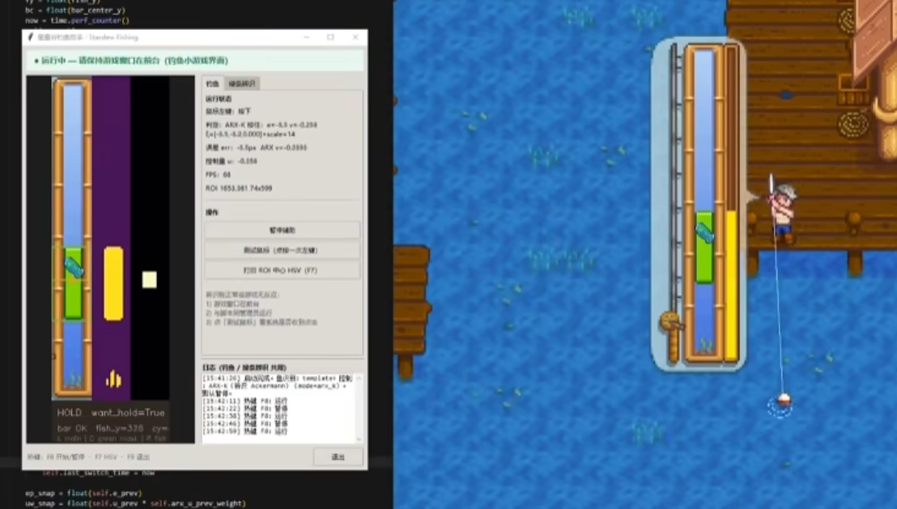

# 星露谷物语 · 钓鱼小游戏辅助

基于 **计算机视觉 + 闭环控制** 的《星露谷物语》（Stardew Valley）钓鱼小游戏自动辅助脚本。通过截取游戏画面中的竖向槽区域，识别「鱼图标」与「绿色有效区域」的纵向位置，自动控制按住/松开使用工具键，使绿条跟随鱼移动。

> **免责声明**：自动化操作可能违反游戏服务条款。本项目仅供视觉识别、控制算法学习与技术交流，请自行评估风险，作者不对任何后果负责。

---

## 预览

| 钓鱼小游戏 ROI（识别目标区域） | 演示视频 |
| :---: | :--- |
|  | **[控制系学生在星露谷全自动钓鱼](https://www.bilibili.com/video/BV1r2SfBfEiX)** |
| 脚本截取的竖向槽：绿色矩形为有效区域，蓝鱼为追踪目标 | bilibili · [BV1r2SfBfEiX](https://www.bilibili.com/video/BV1r2SfBfEiX) |

---

## 功能概览

| 模块 | 说明 |
|------|------|
| `fishing_bot.py` | 主程序：实时截屏、识别、PD/ARX-K 控制、Tkinter 图形界面 |
| `roi_calibrator.py` | ROI 屏幕坐标可视化校准 |
| `template_mark_tool.py` | 框选鱼图标，生成模板图 |
| `debug_recognition.py` | 离线调试图像识别效果 |
| `bar_system_id.py` | 绿条 ARX 系统辨识 + Ackermann 增益设计 |
| `image_io.py` | Windows 中文路径兼容的图像读写 |

---

## 环境要求

- **操作系统**：Windows 10/11（已在 Windows 上开发与测试）
- **Python**：3.10 及以上（推荐 3.12）
- **游戏设置**：窗口化或无边框窗口；钓鱼键绑定为默认 **C**（使用工具）
- **权限**：若游戏以管理员运行，脚本也需以管理员运行，否则按键无效

---

## 快速开始

### 1. 克隆仓库并安装依赖

```bash
git clone https://github.com/<your-username>/stardew-fishing-bot.git
cd stardew-fishing-bot

python -m pip install -r requirements.txt
```

依赖包：`opencv-python`、`numpy`、`mss`、`pynput`、`pillow`

### 2. 准备配置文件

若目录下没有 `config.json`，请复制示例配置：

```bash
copy config.example.json config.json
```

### 3. 校准 ROI（必做）

ROI 是屏幕上钓鱼小游戏**左侧竖条**的截取区域，必须与你的分辨率、窗口位置匹配。

1. 启动游戏，进入钓鱼小游戏界面（或任意可参考的钓鱼 UI）
2. 运行校准工具：

   ```bash
   python roi_calibrator.py
   ```

   或双击 `run_roi_calibrator.bat`

3. 拖动 **Adjust** 窗口的滑块，使黄框恰好盖住竖条（包含鱼图标和绿色矩形）
4. 按 **S** 保存到 `config.json`

### 4. 制作鱼模板（推荐）

模板匹配（`fish_detect_mode=template`）通常比纯颜色分割更稳定。

1. 在校准好的 ROI 区域内截图（尺寸须与 `roi.width × roi.height` 一致）
2. 运行标注工具：

   ```bash
   python template_mark_tool.py 你的截图.png
   ```

3. 鼠标拖框包住整条鱼，按 **S** 保存
4. 模板将写入 `templates/fish_template.png`，并自动更新 `config.json`

### 5. 启动主程序

```bash
python fishing_bot.py
```

或双击 `run_fishing_bot.bat`

**默认处于暂停状态**，不会向游戏发送按键。点击界面「开始辅助」或按 **F8** 后才开始自动控制。

---

## 图形界面说明

主窗口分为左右两栏：

- **左侧**：实时预览（主画面 + 绿条掩膜 + 鱼掩膜 + 状态栏）
- **右侧**
  - **钓鱼** 标签：运行状态、误差、控制量；开始/暂停、测试按键
  - **绿条辨识** 标签：手动系统辨识实验（高级）
  - **日志**：识别与控制信息

### 全局热键

| 按键 | 功能 |
|------|------|
| F8 | 开始 / 暂停辅助 |
| F9 | 退出程序 |
| F7 | 采样 ROI 中心 HSV 并写入日志 |

### 排查「识别正常但游戏无反应」

1. 确保游戏窗口在前台
2. 脚本与游戏使用相同权限（都普通用户，或都管理员）
3. 点击「测试按键（点按一次 c）」确认系统能收到模拟输入
4. 确认游戏内「使用工具」键绑定为 **C**

---

## 配置文件说明（config.json）

### ROI

```json
"roi": {
  "left": 0,
  "top": 0,
  "width": 80,
  "height": 600
}
```

屏幕坐标系：左上角为原点，`left/top` 为 ROI 左上角，`width/height` 为像素宽高。**必须用 `roi_calibrator.py` 校准。**

### 鱼识别模式 `fish_detect_mode`

| 值 | 说明 |
|----|------|
| `template` | **推荐**。OpenCV 模板匹配，需 `templates/fish_template.png` |
| `warm` | 暖色 HSV 分割（褐/橙/黄鱼） |
| `green_mix` | 宽绿域减纯绿条（灰绿、黄绿鱼） |
| `texture` | 纹理/边缘显著性（花纹鱼） |
| `hybrid` | `green_mix` + `texture` 合并 |

### 模板匹配 `template_match`

```json
"template_match": {
  "fish_image": "templates/fish_template.png",
  "method": "ccoeff_normed",
  "min_score": 0.38,
  "multi_scale": true,
  "scale_min": 0.72,
  "scale_max": 1.28,
  "scale_steps": 7
}
```

- `min_score` 过高会漏检，过低会误检。可用 `debug_recognition.py` 查看「原始最高分」后调整
- `multi_scale` 缓解截图分辨率与模板不一致的问题

### 颜色阈值

```json
"green_hsv": { "low": [35, 80, 80], "high": [95, 255, 255] },
"fish_hsv":   { "low": [22, 10, 35], "high": [95, 255, 255] }
```

OpenCV HSV 范围：`[H, S, V]`，H ∈ [0,179]。按 **F7** 在游戏内采样 ROI 中心颜色辅助调整。

### 控制器 `control`

```json
"control": {
  "mode": "pd",
  "kp": 0.04,
  "kd": 0.18,
  "deadband_px": 2,
  "loop_hz": 60,
  "smooth_alpha": 0.5,
  "hysteresis_u": 0.08
}
```

| 字段 | 说明 |
|------|------|
| `mode` | `pd`（默认）或 `arx_k`（需先系统辨识） |
| `kp` / `kd` | 位置/速度增益；`kd` 越大越能抑制绿条惯性 |
| `deadband_px` | 误差死区（像素），减小按键抖动 |
| `loop_hz` | 主循环频率 |
| `hysteresis_u` | 施密特迟滞，防止控制量在零附近频繁翻转 |
| `arx_k` | 长度为 3 的 Ackermann 增益向量（`mode=arx_k` 时使用） |

---

## 离线调试识别

无需启动游戏循环，用静态图片验证参数：

```bash
# ROI 小图（任意尺寸会自动缩放）
python debug_recognition.py 截图.png

# 整屏截图（先按 roi 裁剪）
python debug_recognition.py 整屏.png --full-frame

# 无图形界面环境
python debug_recognition.py 截图.png --no-window
```

或双击 `run_debug_recognition.bat 截图.png`

---

## 绿条系统辨识（高级 / ARX-K 控制）

若 PD 参数难以调好，可对绿条单独做离散系统辨识，得到 ARX 模型并设计状态反馈增益 `K`。

### 方式一：图形界面

1. 进入钓鱼小游戏，确保绿条在 ROI 内可见
2. 打开主程序 → **绿条辨识** 标签
3. 点击「开始手动辨识」，**自行按/松鼠标左键**约 25 秒
4. 辨识结束后点击「离线拟合」，查看日志中的 `K = [...]`
5. 按提示写入 `config.json` 的 `control.arx_k`，并设 `control.mode` 为 `arx_k`

### 方式二：命令行

```bash
# 在线辨识（人工按/松鼠标）
python bar_system_id.py identify --seconds 25 --manual

# 对已保存数据离线拟合
python bar_system_id.py fit --input bar_id_data.npz
```

数据默认保存为 `bar_id_data.npz`（已加入 `.gitignore`）。

---

## 批处理脚本（Windows）

| 文件 | 作用 |
|------|------|
| `run_fishing_bot.bat` | 启动主程序 |
| `run_roi_calibrator.bat` | 启动 ROI 校准 |
| `run_template_mark_tool.bat` | 启动模板标注（需传图片路径） |
| `run_debug_recognition.bat` | 离线识别调试 |
| `run_bar_system_id_identify.bat` | 命令行辨识 |
| `run_bar_system_id_fit.bat` | 命令行离线拟合 |

---

## 推荐调参流程

```
校准 ROI → 制作鱼模板 → debug_recognition 验证
    → 运行 fishing_bot（先暂停观察预览）
    → 微调 min_score / green_hsv
    → F8 开始辅助，调 control.kp/kd
    → （可选）绿条辨识 → arx_k 控制
```

---

## 项目结构

```
stardew-fishing-bot/
├── docs/
│   └── preview.png         # README 预览图
├── fishing_bot.py          # 主程序
├── roi_calibrator.py       # ROI 校准
├── template_mark_tool.py   # 鱼模板标注
├── debug_recognition.py    # 离线识别调试
├── bar_system_id.py        # 绿条系统辨识
├── image_io.py             # 图像读写工具
├── config.json             # 运行配置（需自行校准）
├── config.example.json     # 配置模板
├── requirements.txt        # Python 依赖
├── templates/
│   └── fish_template.png   # 鱼模板（自行生成，默认不提交）
├── run_*.bat               # Windows 快捷启动
└── README.md
```

---

## 常见问题

**Q：预览里看不到绿条/鱼？**  
A：检查 ROI 是否对准竖条；用 F7 采样 HSV；运行 `debug_recognition.py` 离线排查。

**Q：模板模式始终「未识别到鱼」？**  
A：确认 `templates/fish_template.png` 存在；降低 `min_score`；模板需与 ROI 截图同比例。

**Q：绿条识别到了但按键无效？**  
A：权限不一致、游戏不在前台、或按键绑定不是 C。用「测试按键」验证。

**Q：鱼 y 坐标偏差大？**  
A：调整 `vision.fish_y_output_up_offset_px`（正值表示输出点上移）。

**Q：能否在 Linux / macOS 运行？**  
A：代码未针对非 Windows 测试。`mss` 截屏与 `pynput` 输入在 Linux 上可能需要额外配置；游戏本身主要面向 Windows。

---

## 开源与贡献

欢迎提交 Issue 和 Pull Request。提交前请：

- 不要提交个人 `config.json` 中的屏幕坐标（可只改 `config.example.json`）
- 不要提交 `config.backup_*.json`、`bar_id_data.npz` 等本地数据
- 除 `docs/preview.png` 外，不要提交个人调试截图或鱼模板（可能涉及版权）

---

## 许可证

请根据你的开源意愿自行添加 LICENSE 文件（如 MIT）。当前仓库未捆绑许可证时，默认保留所有权利。
